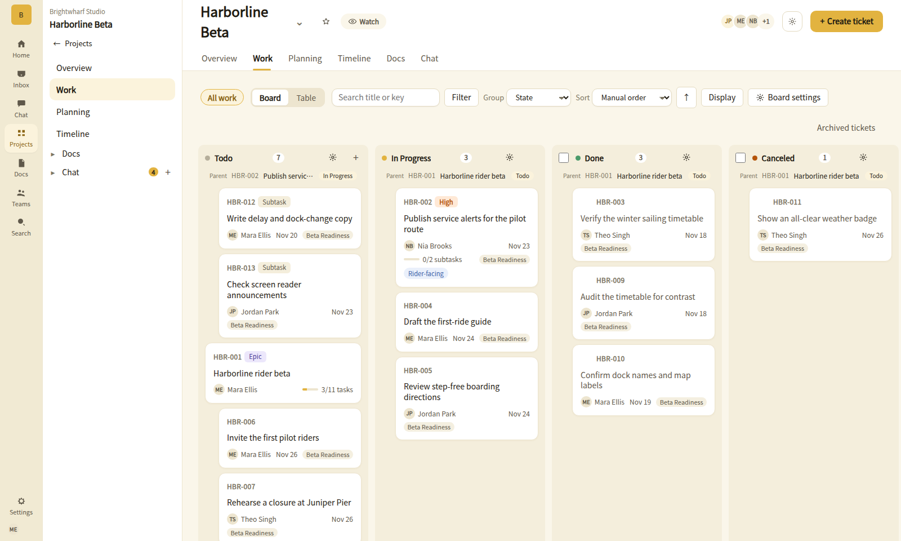
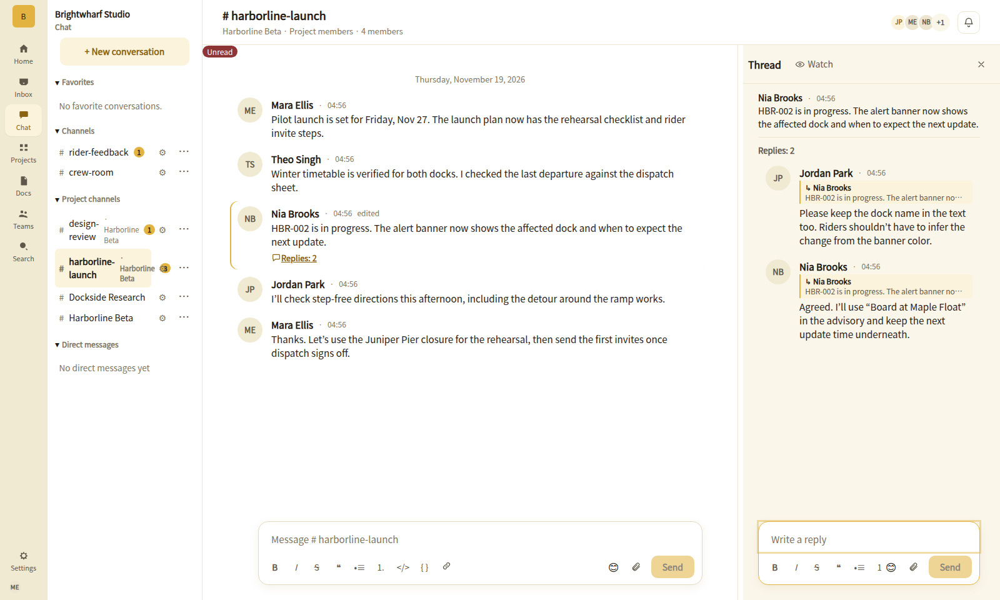
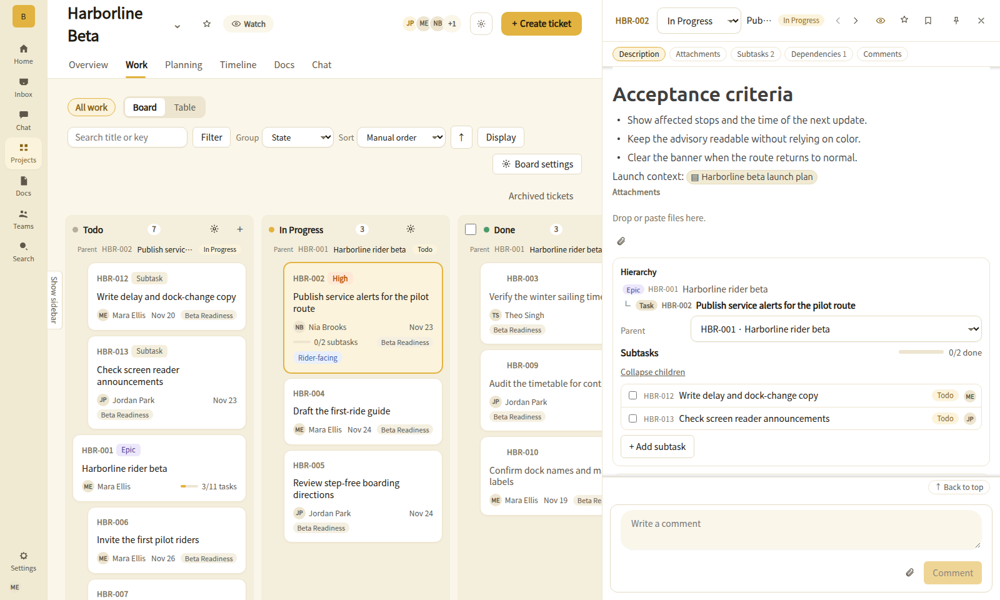
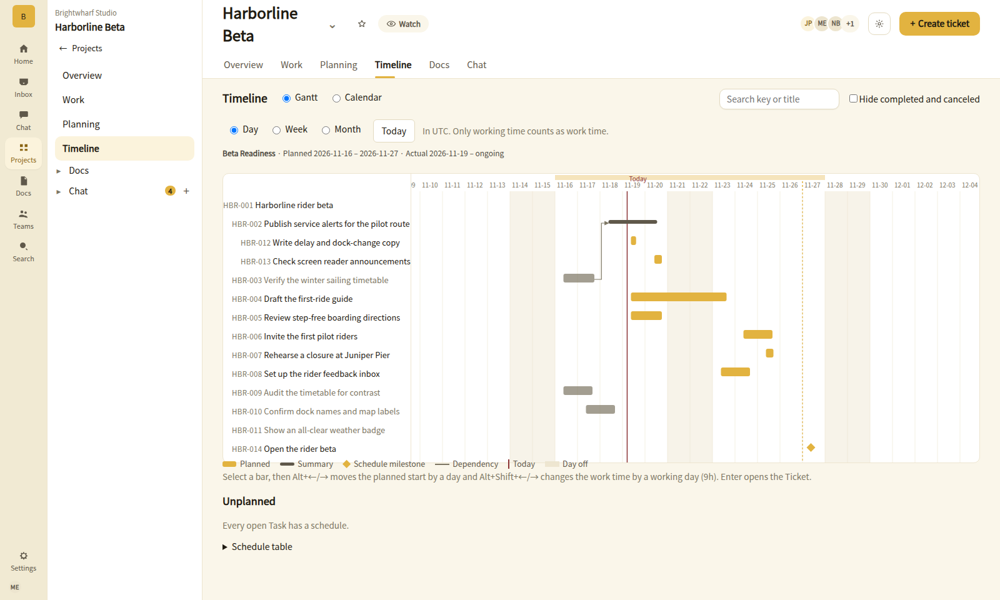
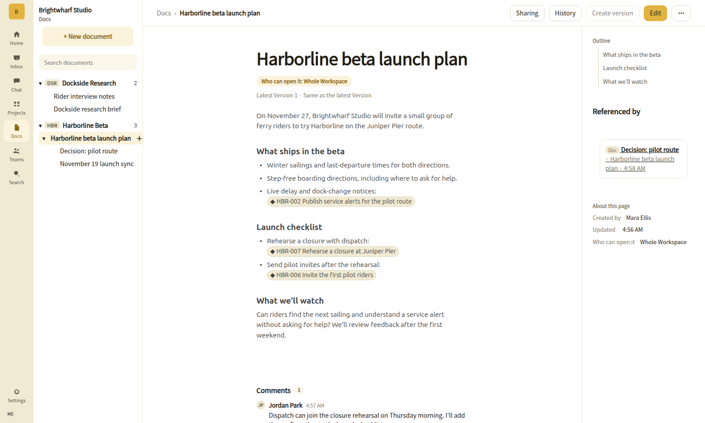

# Penfii

Penfii is an open-source, self-hosted workspace for team chat, projects, tickets, and documentation. Turn a conversation into a ticket, track it on a project board, and record the decision in a document linked to the ticket so teammates can find the context later.

[Quick start](#quick-start) · [Product screenshots](#product-screenshots) · [User guide](docs/user-guide.md) ([한국어](docs/user-guide.ko.md)) · [Self-hosting guide](docs/self-hosting.md) · [Contributing](CONTRIBUTING.md)



*The Harborline Beta project board in Penfii v0.3.0, using a fictional ferry-app launch.*

## Why Penfii?

- **Keep the context with the work.** Create tickets from chat messages, link tickets and documents, and search across the workspace when you need to pick up where someone left off.
- **Manage access across one workspace.** Workspace roles and resource membership determine who can see or change things. The server enforces those permissions and rechecks search results before returning them.
- **Run it on your own infrastructure.** You choose where Penfii runs and manage its database, file storage, and backups.

## What you can do

| Area | What it helps you do |
| --- | --- |
| Chat | Discuss work in public or private channels, send direct messages, and keep replies in threads. |
| Projects and tickets | Organize work into epics, tasks, and subtasks. Track progress on boards and tables, plan sprints and milestones, and see dates on a timeline or calendar. |
| Documents | Organize team knowledge in a page tree, start from templates, comment on pages, and restore saved versions. |
| Search and follow-up | Search messages, tickets, and documents, and find files by filename. Use Inbox, Watch, Later, and Reminders to keep up with work you care about. |

## Product screenshots

<details>
<summary>Follow the Harborline team from chat to the launch plan</summary>

**Workspace chat.** The team discusses service alerts in a project channel and works through the wording in a thread.



**Ticket detail.** The service-alert ticket shows acceptance criteria, a link to the launch plan, and its place in the epic and subtask hierarchy.



**Timeline.** The Gantt view shows scheduled work, a dependency, and the date the team plans to open the beta.



**Documentation.** The launch plan links to the tickets for the rehearsal, rider invites, and service alerts.



</details>

## Connect an AI client with MCP

The optional Model Context Protocol (MCP) gateway lets compatible AI clients work in Penfii on behalf of a person who approves the connection in their browser: read and write Tickets, Docs, channel messages and threads, plan sprints, manage Projects, Teams and invitations, search, and handle their own Inbox. The gateway checks that person's existing permissions, the OAuth scopes they granted and the workspace's MCP policy, and logs tool calls. A workspace can allow supported writes, restrict access to reads, or close MCP access. Account security, OWNER/ADMIN roles, permanent deletes, webhook secrets and Push registration stay in the web app. See [the tool list](docs/mcp-tools.md).

MCP is **off by default**. To enable it, set `PENFII_MCP_ENABLED=1` and configure `PENFII_PUBLIC_URL` with HTTPS, or HTTP on `localhost` or `127.0.0.1` for local use. Clients connect to `/mcp` on that origin and use OAuth with PKCE. Dynamic client registration is a separate setting. See the [MCP setup guide](docs/self-hosting.md#the-mcp-gateway-optional) and [configuration reference](docs/configuration.md#mcp-gateway) for client requirements and policy defaults.

## Quick start

You need Docker with Compose v2 (and Git for the source route). Plan for at least 4 GiB of host memory. Docker Compose is the supported deployment method.

**From a release (no source, no build):** download `penfii-vX.Y.Z-docker.zip` and `SHA256SUMS` from [GitHub Releases](https://github.com/penfii/penfii/releases), unpack it, copy `.env.example` to `.env`, replace every `CHANGE_ME`, then `docker compose pull && docker compose up -d` and create the first account as in step 3. The [installation guide](docs/self-hosting.md#install-from-the-release-zip) has the details. The images are `linux/amd64`.

**From source:** this builds Penfii on your machine, so the first start takes several minutes.

1. Clone the repository and check out the `v0.4.1` release tag.

   ```sh
   git clone --branch v0.4.1 https://github.com/penfii/penfii.git
   cd penfii/docker
   cp .env.example .env
   ```

2. Edit the `.env` file you just copied and replace every `CHANGE_ME`. The database owner and runtime passwords must use only letters and digits. Keep `PENFII_PUBLIC_URL=http://localhost:8080` for a local start. See the [installation guide](docs/self-hosting.md#install) for the full settings, then build the stack.

   ```sh
   docker compose up -d --build
   ```

3. Create the first workspace and its owner's account. Replace the example email and time zone with your own.

   ```sh
   docker compose run --rm admin-cli bootstrap \
     --email owner@example.com --display-name Owner --workspace-name Penfii --time-zone Asia/Seoul
   ```

   The command prompts for a password and confirmation without displaying either. Use 15 to 128 characters and avoid known weak passwords. For automation, pipe the password in with `--password-stdin` and `docker compose run -T` to keep it out of the command line.

4. Open <http://localhost:8080> and sign in. Try creating a project and a ticket, then search for the ticket by title. Add teammates by invitation under **Settings** > **Workspace** > **Invitations**. The [user guide](docs/user-guide.md) ([한국어](docs/user-guide.ko.md)) walks through chat, tickets, documents and search.

Before opening the instance to others, follow the [network and TLS guide](docs/self-hosting.md#network-and-tls). Keep the bundled OpenSearch service internal because its image has no security plugin (no authentication). Back up both [PostgreSQL and the file store](docs/self-hosting.md#backup).

## Project status and upgrades

**v0.4.1 is an early release.** The API, database schema, and settings may change between 0.x releases. Back up before upgrading and check the [upgrade instructions](docs/self-hosting.md#updating) and [changelog](CHANGELOG.md) for your starting version. The web editor saves documents explicitly and has no live co-editing. Run a single API instance for live updates. See [known limitations](docs/known-limitations.md) before hosting Penfii for a team.

## Architecture and documentation

The React and TypeScript web app talks to a Rust API. PostgreSQL holds workspace data and permissions, OpenSearch indexes workspace content, and MinIO provides S3-compatible file storage in the Compose stack. The stack applies database migrations through the operator CLI before starting the API.

| Path | What you'll find |
| --- | --- |
| [`server/`](server) | HTTP API, WebSockets, background workers, [OpenAPI description](server/api/openapi.json), and the `admin-cli` operator tool. |
| [`client/`](client) | Web app and shared npm packages. |
| [`database/`](database) | PostgreSQL migrations. |
| [`docker/`](docker) | Compose stack and Dockerfiles. |

The [documentation index](docs/README.md) links to the [user guide](docs/user-guide.md), [configuration reference](docs/configuration.md), [operator guide](docs/operations.md), [architecture overview](docs/architecture.md), and [development guide](docs/development.md), which also describes [how releases are made](docs/development.md#releases). To build on the HTTP API, start with [Using the API](docs/api.md).

## Contributing, security, and license

- [Report a bug or suggest an improvement](https://github.com/penfii/penfii/issues/new/choose) using the matching issue form.
- Code and documentation pull requests are welcome. See the [contribution guide](CONTRIBUTING.md) and [Code of Conduct](CODE_OF_CONDUCT.md).
- Report vulnerabilities privately using the [security policy](SECURITY.md).

Copyright © 2026 Penfii contributors. Penfii is licensed under the [GNU General Public License v3.0 only](LICENSE) (`GPL-3.0-only`). Third-party licenses are listed in the [server notices](server/THIRD-PARTY-NOTICES.md) and [client notices](client/THIRD-PARTY-NOTICES.md).
